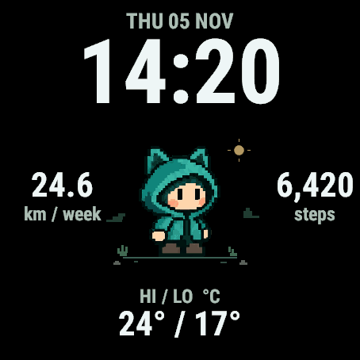
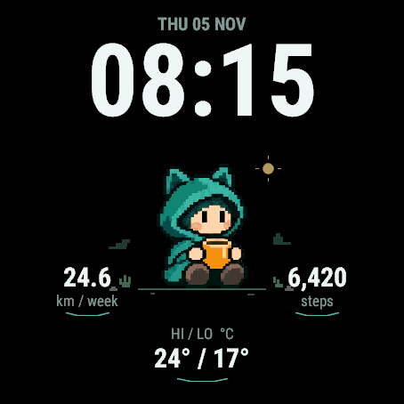
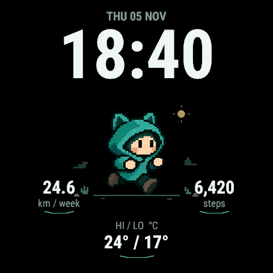
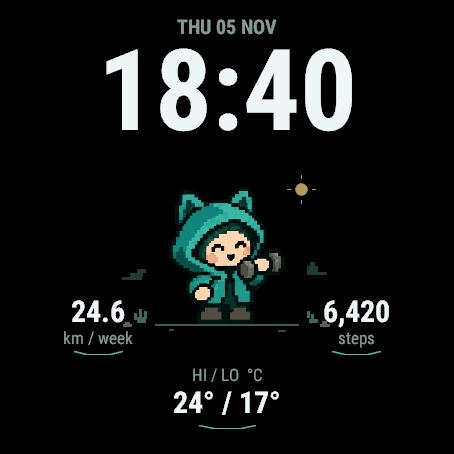
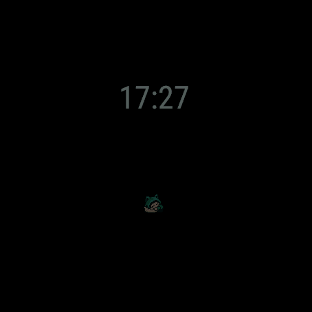

# Little Companion — v0.1

A personal Garmin watch face built around one cozy teal hooded creature. Large
24-hour time and date sit above the companion; running kilometres and daily steps
flank the companion, with today's Celsius high/low below it. The supporting
text is enlarged for readability, and the data fields have no decorative arcs.

Primary device: **Forerunner 570 47 mm**. Additional build targets are Forerunner
570 42 mm, 965, and 970. The 570 47 mm has been sideloaded and tried on the
physical watch; the other models are build targets awaiting device testing.

The companion shares your day: morning coffee, quiet moments, little stretches,
running and strength-themed reactions, then a sleepy evening. Everything happens
automatically, with brief gestures and supportive celebrations after activity.

## Current watch-face layout



- Large 24-hour clock, with the date above it.
- Weekly running distance in kilometres, counted Sunday–Saturday.
- Daily steps and today's forecast high/low in °C.
- A small companion on a sparse ground line, with lightweight environmental details.

This is the latest layout, also copied to the physical Forerunner 570 47 mm.
The screenshot uses demonstration readings rather than personal activity data.

## A day with your companion

| Morning coffee | Quiet daytime |
| :---: | :---: |
|  |  |
| A cozy coffee break, with an occasional sip. | Blinks, stretches, and sometimes notices you looking. |
| **Running theme** | **Strength theme** |
|  |  |
| Recorded runs bring running-themed poses and a celebration. | Recorded Training sessions bring strength-themed poses under the personal-use convention. |

These are screenshots from the actual renderer in Garmin's 570 simulator, using
fixed demonstration values. Coffee, running, and strength captures show an earlier
layout with smaller text and field arcs; the current layout above applies to all
of these scenes. Workout reactions appear when you return to the
watch face. After the celebration, the companion drinks water, stretches, and
rests before returning to its routine.

Always-on keeps just the dim time and a small resting companion:



## Performance expectations

The 570 simulator benchmark exercised **643 draws**, including every pose,
always-on mode, and 240 sprite changes. Normal cached draws averaged **22.1 ms**;
always-on draws averaged **5.1 ms**. Sampled application memory peaked at
**22.7 KiB out of 123.8 KiB**. The bounded run completed without errors.

These measurements come from the earlier layout and font sizes. They support
the intended brief pose changes, roughly 600 ms apart. The wearer reported that
the face felt responsive on the physical 570 47 mm; battery life and redraw times
have not been measured on hardware.
Real workout-history access is the main unmeasured source of possible delays.
See the [performance report](docs/design/performance.md) for the method, outliers,
and remaining hardware checks.

## Build and run

Install Garmin's [Connect IQ SDK Manager](https://developer.garmin.com/connect-iq/sdk/)
and download the target device from its Devices tab. Java is required by the compiler.
The scripts use `CIQ_SDK` if set, the project's ignored `.tools/sdk` when present,
or the SDK Manager's current SDK.

```sh
export DEVELOPER_KEY=/absolute/path/to/your/garmin/developer_key
./scripts/build.sh                  # release build for fr57047mm
./scripts/run.sh                    # build and launch in Garmin's simulator
./scripts/test.sh                   # compile and execute behavior tests
./scripts/build.sh fr57042mm        # optional smaller-screen target
python3 scripts/benchmark.py        # simulator-only render/memory benchmark
python3 scripts/build-previews.py   # documentation scenes with sample values
```

The existing local signing key is the default when available. Its contents are
never copied into the project. SDK downloads and build outputs are ignored by Git.

The sideloadable file is `build/LittleCompanion-fr57047mm.prg`. Transfer it to the
watch's `GARMIN/Apps` directory using your normal Garmin USB/MTP workflow, then
choose **Little Companion** in the watch-face picker. This project does not publish
or install itself on the watch.

On macOS, the watch's MTP storage does not appear as a normal Finder drive. Use
[OpenMTP](https://openmtp.ganeshrvel.com/) and select **MTP** in the watch's USB Mode
setting if needed. Copy only the normal release `.prg`, not a `performance-` or
`preview-` build.

## Behavior

- Wakes at 07:00, begins evening yawns at 20:00, and sleeps at 21:00 by default.
- Eats lunch from 12:00 until 13:00 local time. Lunch and evening sleepiness take
  priority over activity reactions; bedtime always starts sleep.
- Morning coffee, idle blinks, occasional waves, stretches, and movement responses
  vary in context-appropriate windows. No interaction or care is required.
- Recorded Running activities receive running responses. Recorded Training
  activities receive strength responses under the wearer's personal convention;
  this does not distinguish strength from cardio subtypes.
- New workouts earn a celebration across three distinct glances, followed by
  roughly 45 minutes of recovery anchored to the workout end. Unseen workouts
  can still be acknowledged later, without restarting recovery.
- The device's step goal gets a bounded celebration. Quiet days never cause
  negative behavior. Daily acknowledgment state survives reloads.
- First installation seeds existing history rather than replaying old workouts.
- Timers stop after a short gesture sequence or entry to low power. Always-on
  shows only a small dim clock and sleeping sprite.

Schedule settings are available through Garmin's app-properties mechanism. The
supported ordering is wake time, evening wind-down, bedtime within the same day;
invalid ordering leaves the last valid schedule in effect.

## Data and performance

Steps and native running distance are sampled no more than twice per minute.
Weather is checked every 15 minutes while awake; history is checked at most every
five minutes while awake, after the initial screen paints. No external weather
service, API key, direct sensor stream, or custom background process is used.

The native running total is used when the watch's first-day-of-week setting is
Sunday. Otherwise the face computes a Sunday-based total from available local
history. A bounded incomplete scan does not present a partial total as complete;
history retention and sync behavior still require real-device validation.

Missing readings display a dash. Yesterday's weather is not carried into today;
scene conditions older than two hours are omitted. A cached forecast is not a
guarantee of live weather or a weather service's accuracy.

Sprites use small palette-based resources, with only the current full-size pose
retained by the renderer. The 390-pixel target has its own reduced sprite assets.
Sparse grass, pebbles, and stepped distant ridges use small drawing primitives;
there is no full-screen background resource, buffer, or continuously moving scenery.
Fonts are cached, device-provided Roboto Condensed; the clock and values use bold
weights to match the accepted concept more closely.

## Artwork

The preview-only concept is in `docs/design/staggered-watch-face-concept.png`.
The generated sprite source is `assets/source/companion-sheet.png`, created with
the built-in image generation tool. Its prompt requested a 4×3 transparent sheet
of the approved teal hooded character in twelve poses: idle, blink, wave,
stretch/yawn, coffee, sip, walk, run, strength, celebration, water, and sleep.

`python3 scripts/prepare_assets.py` mechanically slices and aligns the sheet,
reduces it with nearest-neighbor sampling, and limits palettes using ImageMagick.
It regenerates both display sizes and the small always-on resource.

See [the design scope](docs/design/v0.1.md), [feasibility review](docs/design/feasibility.md),
and [validation record](docs/design/validation.md) for accepted behavior and limits.
